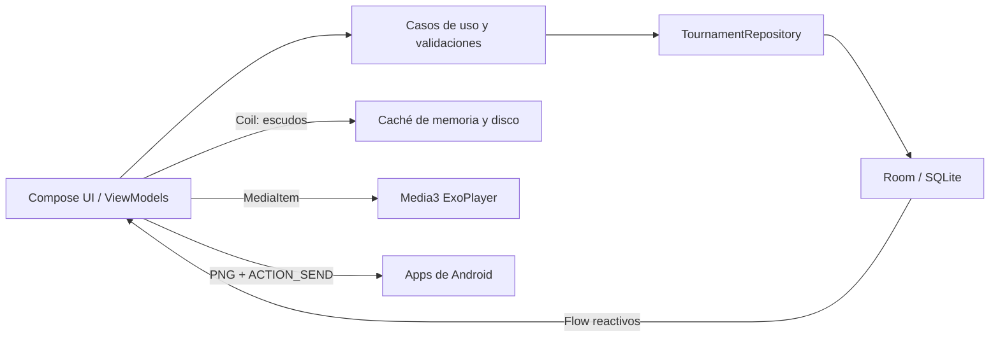

# Liga Hog Rana

Aplicación Android offline-first para administrar torneos de fútbol: equipos, jornadas, actas, eliminatorias, estadísticas e historial de goles. La interfaz está construida con Kotlin y Jetpack Compose; Room es la fuente de verdad local.

## Inicio rápido

**Requisitos:** JDK 17 y Android SDK API 35. Conecta un dispositivo o inicia un emulador para instalar y probar la app.

En Windows/PowerShell, desde la raíz:

```powershell
.\gradlew.bat assembleDebug
.\gradlew.bat installDebug
```

`assembleDebug` compila y ejecuta `lintDebug`. El APK queda en `app\build\outputs\apk\debug\app-debug.apk`.

## Funcionalidades

| Área | Qué permite |
|------|-------------|
| Equipos | Elegir clubes de tres catálogos, buscar, registrar capitanes y crear equipos con escudo local persistente. |
| Inicio | Consultar podio, tabla de posiciones y cruces/descansos de la jornada más reciente. |
| Fase regular | Sortear jornadas con rotación de descansos o crear/reasignar partidos manualmente con validación de equipos repetidos. |
| Actas | Registrar marcador, goleadores, asistencias, atajadas, faltas, tarjetas y MVP; editar conserva los eventos guardados. |
| Eliminatorias | Armar octavos con los mejores clasificados, sorteo o selección manual; avanzar por ida/vuelta y resolver empates con penales. |
| Compartir | Generar una imagen con escudos, marcador, global/penales, eventos y MVP para compartir con el selector de Android. |
| Estadísticas | Consultar goleadores, asistentes, atajadores y tarjetas acumuladas. |
| Historial | Guardar enlaces públicos de Drive o vídeos locales y reproducirlos con Media3. |

## Arquitectura y flujo de datos



## Documentación

- [Especificación funcional](./docs/spec-kit/2_spec.md)
- [Plan técnico](./docs/spec-kit/3_plan.md)
- [Contratos de persistencia](./docs/spec-kit/6_contracts.md)
- [Quickstart y smoke test](./docs/spec-kit/7_quickstart.md)
- [Tareas y estado de fases](./docs/spec-kit/8_tasks.md)
- [Informe de implementación](./docs/INFORME_IMPLEMENTACION.md)

Las cuatro fases funcionales están implementadas. El perfilado cuantitativo de RAM en Android Studio Profiler queda pendiente de una ejecución en dispositivo/emulador; no se da por hecho solo a partir de la compilación.
