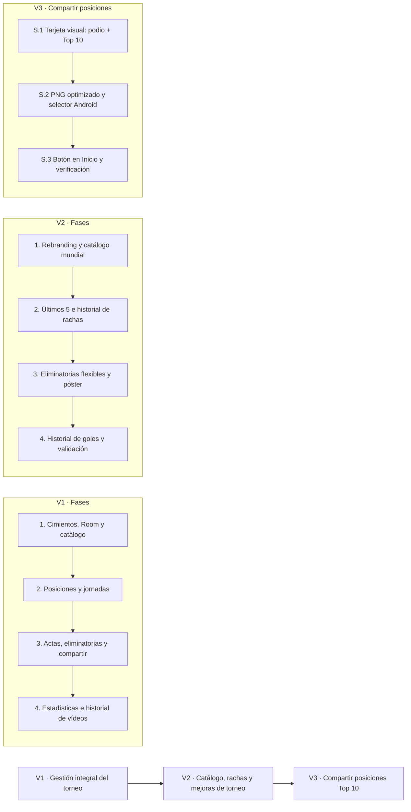
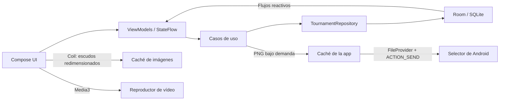

# La liga Alfa Bravo

Aplicación Android offline-first para organizar torneos de fútbol. Administra equipos, jornadas, actas, posiciones, eliminatorias, estadísticas y vídeos; Room conserva los datos localmente y Jetpack Compose presenta la interfaz.

## Inicio rápido

**Requisitos:** JDK 17 y Android SDK API 35. Para instalar y recorrer el flujo funcional, usa un emulador o dispositivo Android conectado.

Desde la raíz del proyecto, en Windows/PowerShell:

```powershell
.\gradlew.bat assembleDebug
.\gradlew.bat installDebug
```

`assembleDebug` incluye `lintDebug`. El APK se genera en `app\build\outputs\apk\debug\app-debug.apk`.

## Evolución del proyecto



### V1 — Gestión integral del torneo

La primera versión establece la aplicación offline-first y sus cuatro secciones: Inicio, Partidos, Estadísticas e Historial. Incluye registro de clubes con capitán, tabla reactiva, sorteo de jornadas con descansos justos, actas completas, eliminatorias de ida y vuelta, exportación de partidos, estadísticas y reproducción de vídeos.

| Fase | Entrega |
|---|---|
| 1. Cimientos y equipos | Compose, Room, catálogo inicial y navegación |
| 2. Inicio y jornadas | Podio, posiciones y generación/edición de partidos |
| 3. Actas y eliminatorias | Eventos, MVP, bracket, global, penales y compartir |
| 4. Estadísticas y vídeos | Tablas de jugadores e historial multimedia |

El checklist V1 registra las funcionalidades como implementadas; el perfilado cuantitativo de RAM en un dispositivo queda pendiente.

### V2 — La liga Alfa Bravo

V2 define el rebranding, el catálogo mundial e histórico, las rachas, las eliminatorias configurables, un póster de partido modernizado y el registro de vídeos asociado a partidos completados.

| Fase | Alcance |
|---|---|
| 1. Marca y catálogo | Nombre e icono, clubes actuales e históricos y selector paginado |
| 2. Rachas | Resultados recientes, columna «Últimos 5» e historial completo |
| 3. Eliminatorias y póster | Clasificación por tabla o cruces manuales, ida/vuelta y nuevo diseño |
| 4. Vídeos y validación | Selección de partido finalizado, equipo, goleador y smoke test |

**Estado de implementación:** el checkpoint V2 registra la Tarea 1.1 completada. Las demás tareas siguen pendientes; la especificación describe el alcance, no implica que esas funciones estén implementadas.

### V3 — Compartir la tabla Top 10

V3 incorpora en Inicio una acción para compartir la tabla oficial como imagen PNG de 1080 × 1440 px. La imagen incluye el podio Top 3, hasta diez equipos, sus estadísticas y los últimos cinco resultados. Los escudos se cargan a tamaño reducido bajo demanda y el archivo temporal se sobrescribe en caché antes de abrir el selector nativo de Android.

| Tarea | Entrega |
|---|---|
| S.1 | Tarjeta compartible con podio, tabla Top 10 y rachas |
| S.2 | Renderizado PNG, escudos reducidos y `ACTION_SEND` con `FileProvider` |
| S.3 | Acción de compartir integrada en el encabezado de Posiciones |

La compilación y lint pasan con `assembleDebug`. La prueba visual del selector en un dispositivo queda pendiente: `adb` no está disponible en el entorno de implementación.

## Arquitectura



## Spec-Kit y documentación

Las especificaciones versionadas están en `docs/spec-kit/`. Cada enlace apunta al archivo real de esa versión:

### V1

- [Especificación funcional](./docs/spec-kit/V1/2_spec.md)
- [Plan técnico y estructura](./docs/spec-kit/V1/3_plan.md)
- [Investigación y decisiones](./docs/spec-kit/V1/4_research.md)
- [Modelo de datos](./docs/spec-kit/V1/5_data_model.md)
- [Contratos y consultas](./docs/spec-kit/V1/6_contracts.md)
- [Quickstart y smoke test](./docs/spec-kit/V1/7_quickstart.md)
- [Tareas y estado](./docs/spec-kit/V1/8_tasks.md)

### V2

- [Constitución](./docs/spec-kit/V2/1_constitution.md)
- [Especificación](./docs/spec-kit/V2/2_specification_v2.md)
- [Plan arquitectónico](./docs/spec-kit/V2/3_plan_v2.md)
- [Investigación y decisiones](./docs/spec-kit/V2/4_research_v2.md)
- [Modelo de datos](./docs/spec-kit/V2/5_data_model_v2.md)
- [Contratos](./docs/spec-kit/V2/6_contracts_v2.md)
- [Quickstart y smoke test](./docs/spec-kit/V2/7_quickstart_v2.md)
- [Tareas V2](./docs/spec-kit/V2/8_tasks_v2.md) · [checkpoint de ejecución](./docs/spec_kit/versiones/v2_liga_alfa_bravo/8_tasks.md)

### V3

- [Especificación: compartir posiciones Top 10](./docs/spec-kit/V3/share_standings_top_10_spec.md)

### Referencias generales

- [Constitución vigente del proyecto](./docs/1_constitution.md)
- [Informe de implementación](./docs/INFORME_IMPLEMENTACION.md)
