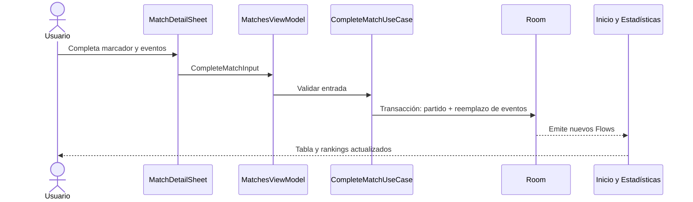
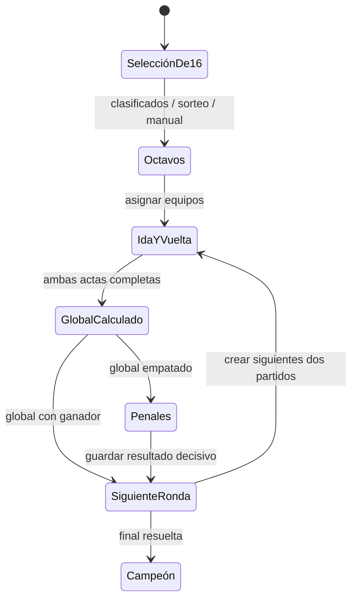
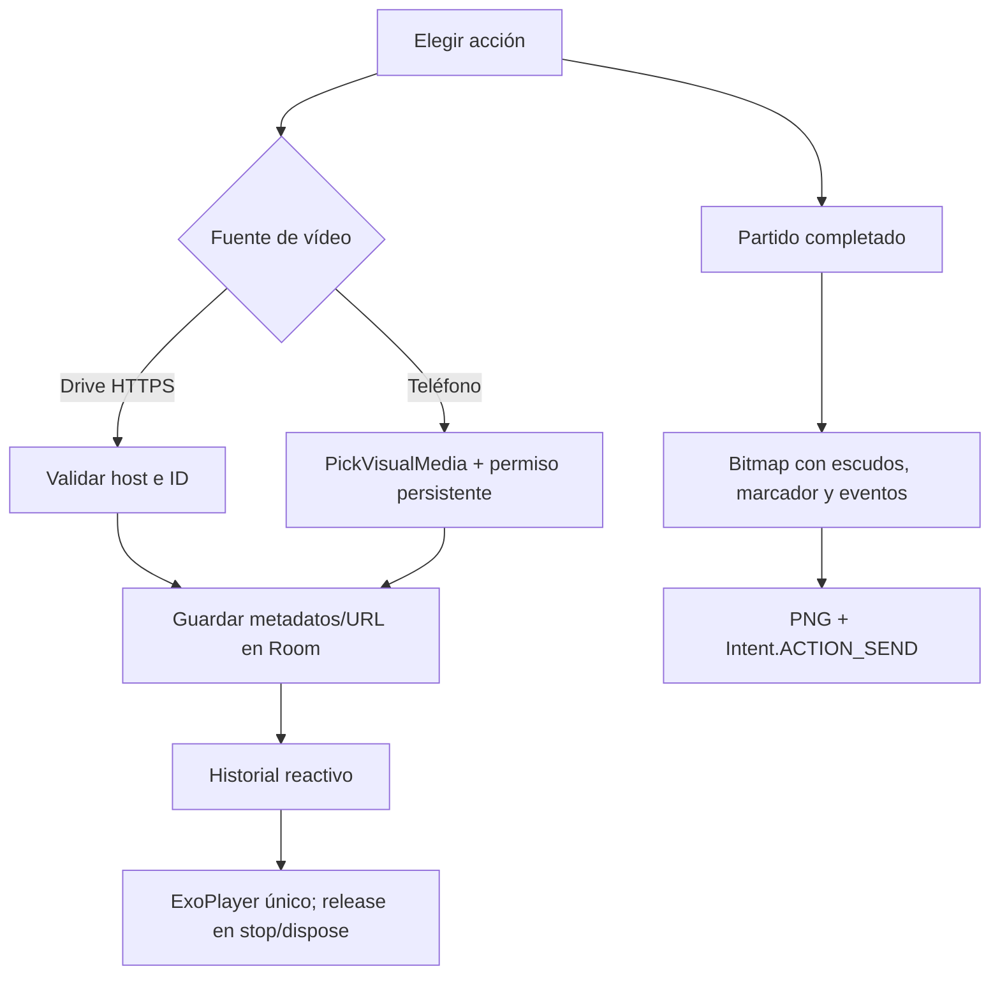

# Informe de implementación — Liga Hog Rana

**Resultado:** las cuatro fases funcionales del Spec-Kit quedaron implementadas y conectadas a Room. El proyecto compila y `assembleDebug` ejecuta lint. La medición de memoria en Android Studio Profiler sigue pendiente porque requiere una ejecución visual en dispositivo/emulador.

## Resumen por fase

| Fase | Entrega | Estado |
|------|---------|--------|
| 1. Cimientos y equipos | Compose, Room, catálogo, navegación, registro de capitán y escudo local persistente. | Completa |
| 2. Posiciones y jornadas | Consulta de tabla, podio, resumen de jornada, descanso visible, sorteo justo y cruces manuales validados. | Completa |
| 3. Actas y eliminatorias | Actas editables sin pérdida de eventos, bracket de 16 equipos, ida/vuelta, global, penales y compartir PNG. | Completa |
| 4. Estadísticas y vídeos | Rankings por eventos, filtros disciplinarios, historial, fuentes Drive/local y reproductor con liberación por ciclo de vida. | Implementada; perfil de RAM pendiente |

El detalle de aceptación está en [8_tasks.md](./spec-kit/8_tasks.md). La guía de ejecución y los pasos de validación están en [7_quickstart.md](./spec-kit/7_quickstart.md).

## Cambios correctivos relevantes

| Problema | Corrección |
|----------|------------|
| El tema Android impedía enlazar recursos. | Se cambió a `Theme.Material.Light.NoActionBar`; `assembleDebug` vuelve a enlazar y generar el APK. |
| La caché Coil pasaba un tamaño `Long` a una API que requiere `Int`; había un import de SVG sin dependencia. | Se limita el tamaño calculado a `Int.MAX_VALUE` y se elimina el import no utilizado. |
| La edición del acta borraba eventos y asignaba a local goles/tarjetas de ambos equipos. | Se cargan eventos existentes antes de habilitar el guardado y se permite elegir el equipo por evento; guardar partido y eventos es transaccional. |
| El descanso generado no aparecía en la lista de partidos. | Se presenta como tarjeta informativa y también en el resumen de Inicio. |
| Las llaves eran espacios vacíos y el botón de bracket no tenía acción. | Se crean las 15 llaves y las dos piernas de octavos; las rondas se generan cuando quedan asignados sus dos equipos. |
| La promoción podía duplicar un equipo en la llave siguiente y los penales podían perderse al actualizar el ganador. | La promoción actualiza filas existentes, es transaccional y conserva la tanda; se bloquea la edición después de determinar un ganador. |
| Compartir no dibujaba escudos ni incluía datos de eliminatoria/atajadas. | El PNG incorpora escudos, resultado, global/penales, eventos, tarjetas y MVP; los errores de carga/compartición se muestran. |
| Historial de vídeos era un placeholder. | Se agregaron formulario, enlaces Drive, selector de vídeo local, lista, reproducción y liberación de ExoPlayer. |
| El build no ejecutaba lint. | `assembleDebug` depende de `lintDebug`, de modo que un único comando valida ambos. |

## Tablas de flujo

| Flujo | Entrada | Validaciones | Escritura/efecto | Resultado visible |
|-------|---------|--------------|------------------|-------------------|
| Registro de equipo | Catálogo o nombre, capitán y escudo | Campos obligatorios y nombre único en Room | Inserta equipo local | El catálogo bloquea equipos registrados |
| Jornada automática | Acción de sorteo | Mínimo dos equipos y jornada no existente | Inserta cruces y actualiza `byeCount` atómicamente | Tarjetas de partidos y descanso |
| Cruce manual | Jornada, local y visitante | Equipos distintos/existentes y sin duplicados en la jornada | Inserta o reasigna partido regular | Jornada actualizada; error explícito si no es válido |
| Completar acta | Resultado, eventos, disciplina, MVP | Valores no negativos, equipos participantes y MVP coherente | Actualiza partido y reemplaza eventos dentro de transacción | Tabla y estadísticas se actualizan por `Flow` |
| Avanzar eliminatoria | Dos actas completadas | Global; si empata, penales con ganador | Guarda ganador, siguiente llave y dos nuevos partidos | El bracket avanza de ronda |
| Compartir partido | Partido completado | Equipos, llave y escudos disponibles | Renderiza PNG en caché y abre `ACTION_SEND` | Android muestra destinos de compartir |
| Guardar/reproducir vídeo | Metadatos y fuente Drive o local | Link Drive HTTPS reconocido o URI local seleccionada | Persiste fuente y referencia en Room | Historial reproducible con Media3 |

## Diagramas

### Acta: escritura y actualización reactiva

### Flujo del bracket

### Vídeos y compartir

## Validación ejecutada

| Comando | Resultado |
|---------|-----------|
| `.\gradlew.bat assembleDebug` | **BUILD SUCCESSFUL**; compila Kotlin, genera el APK y ejecuta `lintDebug`. |
| `lintDebug` | **SUCCESS** dentro de `assembleDebug`. Gradle imprimió avisos de compatibilidad de Kotlin Analysis API, pero la tarea terminó correctamente. |
| Smoke de interfaz en dispositivo | No ejecutado en esta sesión; consultar los pasos reproducibles en `7_quickstart.md`. |
| Android Studio Profiler | Pendiente; requiere medir una sesión real en dispositivo/emulador. |

## Límite de alcance documentado

La opción de tema claro/fuentes que aparece como propuesta en investigación no está en la especificación funcional ni en las tareas de aceptación actuales. Se conserva como evolución futura en [4_research.md](./spec-kit/4_research.md), no como parte de esta entrega.
